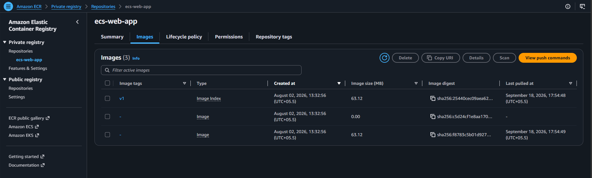
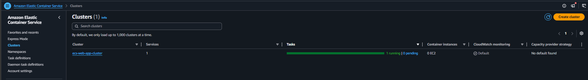
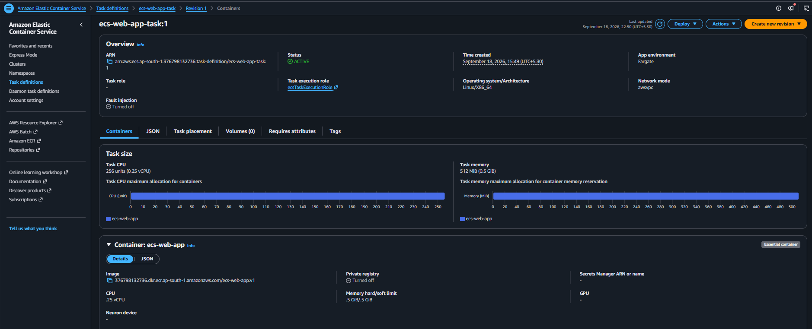
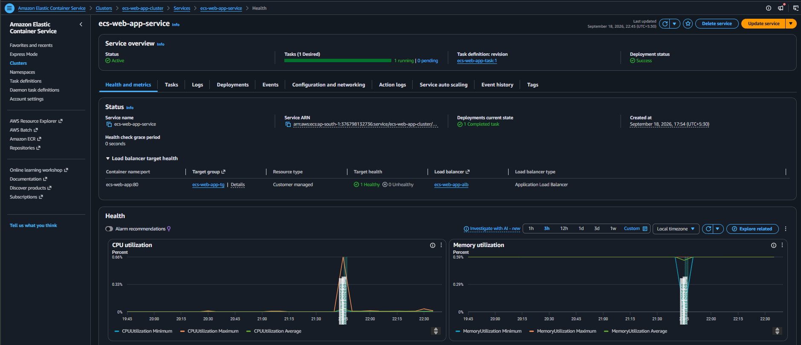
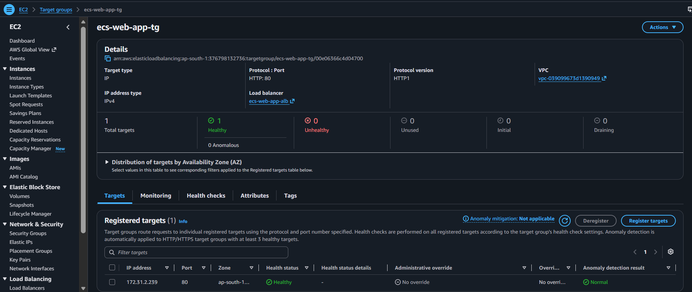
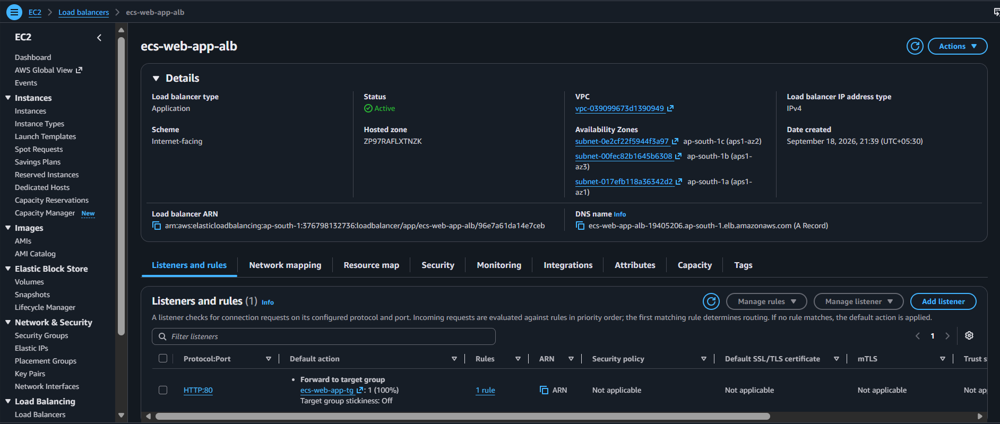
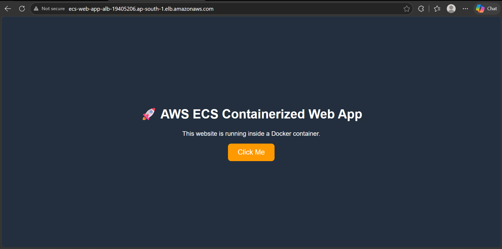
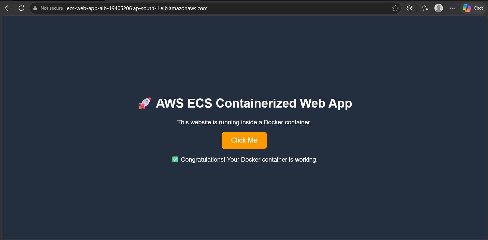

# AWS Containerized Web Application

A production-grade demonstration of containerizing a modern web application with Docker and Nginx, pushing the container image to Amazon Elastic Container Registry (ECR), and deploying it serverlessly on Amazon Elastic Container Service (ECS) with AWS Fargate behind an Application Load Balancer (ALB).

---

## 🏛️ Architecture Overview

The application architecture follows AWS container deployment best practices, utilizing an Application Load Balancer to distribute incoming internet traffic across serverless Fargate tasks running inside an Amazon Virtual Private Cloud (VPC).

```
Internet
   ↓
Application Load Balancer (ALB)
   ↓
Target Group (Health Checks: HTTP /)
   ↓
Amazon ECS Service
   ↓
AWS Fargate Task (Serverless Compute)
   ↓
Nginx Container (Port 80)
   ↓
Web Application (HTML / CSS / JavaScript)
```

### Architecture Breakdown & Component Roles

1. **Application Load Balancer (ALB)**:
   - Deployed across multiple Availability Zones in public subnets (`ap-south-1a`, `ap-south-1b`, `ap-south-1c`).
   - Acts as the single entry point for incoming internet HTTP traffic on port 80.
   - Forwards client requests to the registered ECS target group.

2. **Target Group & Health Checks**:
   - Uses `ip` target type, routing traffic directly to the private IP address of the Fargate task (`172.31.2.239:80`).
   - Continuously runs health checks against the root path (`/`) to ensure the Nginx web server is healthy and responding before routing user traffic.

3. **Amazon ECS Service**:
   - Manages and maintains the desired task count (1 running task).
   - Coordinates with the target group to seamlessly register tasks and monitor deployment status.

4. **AWS Fargate (Serverless Compute)**:
   - Eliminates the operational overhead of provisioning, configuring, and scaling EC2 instances.
   - Tasks execute on demand with precisely provisioned compute resources (0.25 vCPU / 512 MiB RAM).

5. **Nginx Container & Web App**:
   - High-performance, lightweight web server serving static assets (HTML5, modern CSS3 styling, and JavaScript logic).

6. **AWS IAM Execution Role (`ecsTaskExecutionRole`)**:
   - Grants the ECS agent permissions to pull the container image from Amazon ECR and publish container runtime logs to Amazon CloudWatch.

7. **Security Groups**:
   - **ALB Security Group**: Allows inbound HTTP traffic on port 80 from anywhere (`0.0.0.0/0`).
   - **ECS Task Security Group**: Restricts inbound traffic on port 80 strictly to requests coming from the ALB Security Group, ensuring tasks cannot be bypassed or accessed directly from unverified sources.

8. **Amazon CloudWatch**:
   - Monitors CPU and memory utilization in real-time.
   - Captures container logs and application events for observability and troubleshooting.

---

## 🛠️ Technologies Used

- **Docker**: Containerization platform packaging application code and Nginx runtime.
- **Amazon Elastic Container Registry (ECR)**: Secure, private Docker container registry on AWS.
- **Amazon Elastic Container Service (ECS)**: Fully managed container orchestration service.
- **AWS Fargate**: Serverless compute engine for ECS containers.
- **Application Load Balancer (ALB)**: Layer 7 load balancer distributing incoming web traffic.
- **Amazon CloudWatch**: Metrics, telemetry, and container logging.
- **AWS IAM**: Least-privilege identity and access management for task execution.
- **AWS CLI**: Command-line interface for AWS resource administration.
- **Web Stack**: HTML5, CSS3, JavaScript, Nginx.

---

## 📂 Repository Structure

```
aws-containerized-web-app-ecs/
├── .gitignore
├── Dockerfile
├── README.md
├── docker-compose.yml
├── app/
│   ├── index.html
│   ├── script.js
│   └── style.css
└── Screenshots/
    ├── 01-ecr-repository.png
    ├── 02-ecs-cluster.png
    ├── 03-ecs-task-definition.png
    ├── 04-ecs-service.png
    ├── 05-target-group.png
    ├── 06-application-load-balancer.png
    ├── 07-application.png
    └── 08-application-request.png
```

---

## 🚀 Implementation & Deployment Steps

### 1. Docker Image Creation & Local Testing

The application is containerized using an official lightweight Nginx image. The `Dockerfile` copies website assets into the default Nginx web root directory and exposes port 80:

```dockerfile
# Use the official Nginx image
FROM nginx:latest

# Copy website files into the Nginx web directory
COPY app/ /usr/share/nginx/html

# Expose port 80
EXPOSE 80
```

#### Local Build & Run

Build the Docker image locally:
```bash
docker build -t ecs-web-app:v1 .
```

Run the container locally to verify functionality:
```bash
docker run -d -p 8080:80 --name my-web-app ecs-web-app:v1
```

Alternatively, run with Docker Compose:
```bash
docker compose up -d
```

Verify by navigating to `http://localhost:8080` in the browser.

---

### 2. Amazon ECR Image Push

1. Create a private repository in Amazon ECR named `ecs-web-app`.
2. Authenticate the local Docker CLI to the Amazon ECR registry:
   ```bash
   aws ecr get-login-password --region ap-south-1 | docker login --username AWS --password-stdin <aws-account-id>.dkr.ecr.ap-south-1.amazonaws.com
   ```
3. Tag the local image for ECR:
   ```bash
   docker tag ecs-web-app:v1 <aws-account-id>.dkr.ecr.ap-south-1.amazonaws.com/ecs-web-app:v1
   ```
4. Push the image to Amazon ECR:
   ```bash
   docker push <aws-account-id>.dkr.ecr.ap-south-1.amazonaws.com/ecs-web-app:v1
   ```

---

### 3. ECS Task Definition

A task definition (`ecs-web-app-task:1`) was created with the following parameters:
- **Launch Type Compatibility**: AWS Fargate
- **Operating System / Architecture**: Linux/X86_64
- **Network Mode**: `awsvpc` (allocates an Elastic Network Interface with private IP to each task)
- **Task CPU**: 0.25 vCPU (256 units)
- **Task Memory**: 0.5 GiB (512 MiB)
- **Task Execution Role**: `ecsTaskExecutionRole`
- **Container Port**: 80 (TCP)
- **Container Image**: `<aws-account-id>.dkr.ecr.ap-south-1.amazonaws.com/ecs-web-app:v1`

---

### 4. Target Group & Application Load Balancer Setup

1. **Target Group (`ecs-web-app-tg`)**:
   - Target type: `IP` (required for Fargate `awsvpc` networking).
   - Protocol / Port: `HTTP:80`.
   - Health check path: `/` (HTTP status 200).
2. **Application Load Balancer (`ecs-web-app-alb`)**:
   - Scheme: Internet-facing.
   - Availability Zones: Mapped to public subnets across 3 AZs.
   - Listener: HTTP on port 80 forwarding 100% of traffic to `ecs-web-app-tg`.

---

### 5. ECS Service Deployment

An Amazon ECS Service (`ecs-web-app-service`) was launched within the cluster `ecs-web-app-cluster`:
- **Desired Tasks**: 1 task running continuously.
- **Compute**: Fargate serverless capacity.
- **Load Balancer Integration**: Attached to `ecs-web-app-alb` and `ecs-web-app-tg`.
- **Health Grace Period**: Allows container startup before health evaluation begins.

---

## 📸 Deployment Screenshots & Verification

### 1. Amazon ECR Repository
The container image `ecs-web-app:v1` pushed and stored securely in Amazon ECR:



---

### 2. Amazon ECS Cluster
The ECS cluster (`ecs-web-app-cluster`) running the active service on Fargate without any EC2 instances:



---

### 3. ECS Task Definition
Configuration details of `ecs-web-app-task:1` specifying Fargate, awsvpc networking, and 0.25 vCPU / 512 MiB sizing:



---

### 4. ECS Service & CloudWatch Metrics
The running service (`ecs-web-app-service`) showing healthy deployment status, target health, and active CloudWatch CPU & memory utilization graphs:



---

### 5. Application Target Group
The target group (`ecs-web-app-tg`) confirming 1 target healthy at IP `172.31.2.239:80`:



---

### 6. Application Load Balancer
The internet-facing ALB configuration (`ecs-web-app-alb`) with DNS endpoint and HTTP:80 forwarding rule:



---

### 7. Web Application Live in Browser
Accessing the application through the public Application Load Balancer DNS name:



---

### 8. Application Request & Interaction Verification
Verifying interactive client functionality and successful request handling:



---

## 💰 Cost Optimization & Cleanup

This project was intentionally engineered with cost-efficiency as a priority to avoid unnecessary cloud expenditures:

- **No NAT Gateway**: Tasks were configured without costly NAT Gateways, eliminating the substantial hourly baseline fee and data processing charges associated with AWS NAT Gateways.
- **Zero EC2 Instance Costs**: AWS Fargate serverless compute was utilized instead of provisioned EC2 instances, eliminating idle server costs.
- **Minimal Task Sizing**: Sized at the smallest tier (0.25 vCPU and 0.5 GiB memory), keeping compute costs to fractions of a cent per hour.
- **Single Task Footprint**: Kept at a single desired task during testing and validation.
- **Temporary ALB**: The Application Load Balancer was provisioned strictly for deployment verification and was decommissioned promptly afterwards.
- **CloudWatch Log Retention**: CloudWatch logs and metrics were configured with minimal retention to prevent continuous storage accumulation.
- **Resource Cleanup**: All billable resources—including the ECS service, task definition revisions, target group, ALB, and Amazon ECR repository—were promptly decommissioned and deleted after testing to prevent ongoing charges.
